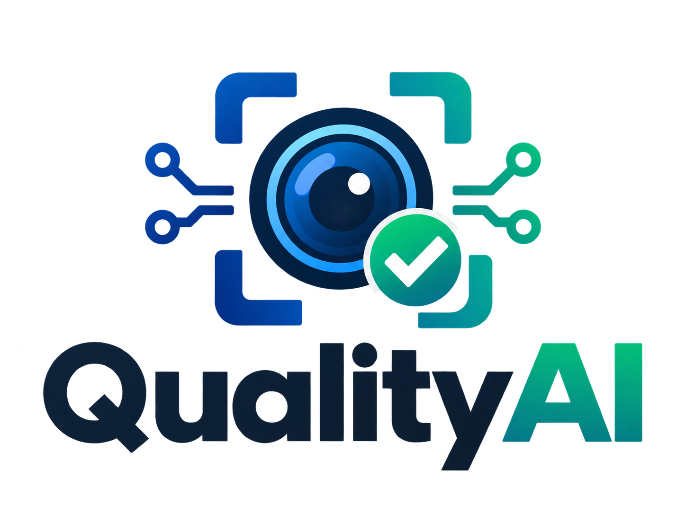
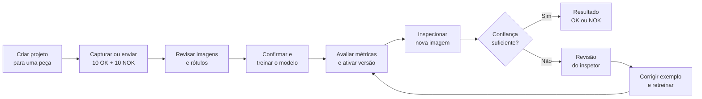
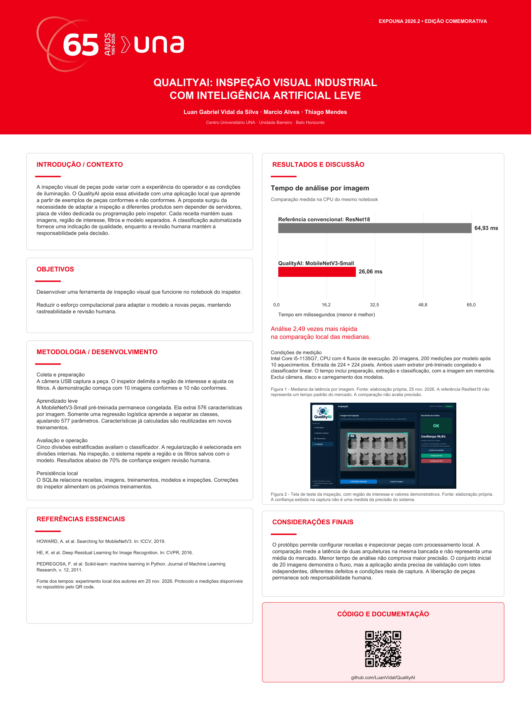

<div align="center">



### Inspeção visual industrial local, configurável e autotreinável

[](#status-do-projeto)
[](#limites-da-prova-de-conceito)
[](#como-funciona)
[](docs/prototipo-desktop.md)

**Ensine o sistema com exemplos reais da sua peça e use inteligência artificial para apoiar uma inspeção mais rápida, consistente e rastreável.**

[Conheça o projeto](#visão-geral) · [Instalação](#executar-o-protótipo) · [Guia do protótipo](docs/prototipo-desktop.md) · [Etapas 1 e 2](docs/etapas-1-e-2.md)

</div>

---

## Integrantes

- Luan Gabriel Vidal da Silva
- Marcio Alves
- Thiago Mendes

## Visão geral

O **QualityAI** é um protótipo desktop de inspeção visual para a indústria. Ele funciona localmente em um notebook Windows, recebe imagens de uma webcam ou câmera USB e permite treinar um classificador sem exigir programação ou conhecimento especializado em inteligência artificial.

Na prova de conceito, cada projeto começa com **10 imagens de peças conformes (`OK`)** e **10 imagens de peças não conformes (`NOK`)**. O usuário delimita uma região de interesse, configura filtros, revisa as imagens e treina um modelo leve para classificar novas capturas.

> O QualityAI foi pensado como uma ferramenta de **apoio à decisão**. A responsabilidade pela liberação de uma peça continua sendo humana, especialmente quando o modelo apresentar baixa confiança.

## Recursos do protótipo

- Interface desktop moderna em PySide6, com a identidade visual oficial do QualityAI e funcionamento offline.
- Receitas independentes por tipo de peça, cada uma com descrição, dataset, ROI, filtros e modelo próprios.
- Captura manual por webcam ou câmera USB, com prévia espelhada para facilitar o posicionamento da peça.
- Delimitação visual da região de interesse (ROI) pelo mouse.
- Filtros de CLAHE, escala de cinza, redução de ruído, nitidez, brilho e contraste.
- Importação de imagens existentes para as classes `OK` e `NOK`.
- Treinamento leve com MobileNetV3-Small congelada e classificador linear.
- Validação cruzada estratificada e métricas de acurácia balanceada, F1 e ROC AUC.
- Resultado `OK`, `NOK` ou `REVISÃO`, acompanhado de confiança e versão do modelo.
- Armazenamento somente no notebook, sem envio de imagens para a nuvem.
- Troca rápida de receita e limpeza protegida do dataset, com arquivamento do modelo anterior.

## Executar o protótipo

Requisitos: Windows 10/11, Python 3.11 e uma câmera compatível com o OpenCV.

```powershell
py -3.11 -m venv .venv
.\.venv\Scripts\python.exe -m pip install -r requirements.txt
.\.venv\Scripts\python.exe run.py
```

No Windows, também é possível executar `instalar-qualityai.bat` uma vez e depois abrir `iniciar-qualityai.bat` com dois cliques.

Na primeira execução do treinamento, o PyTorch pode baixar os pesos públicos da MobileNetV3-Small. Depois disso, o fluxo funciona localmente.

## Como funciona



| Entrada | Processamento | Saída |
| --- | --- | --- |
| Imagens obtidas por upload ou câmera | Treinamento confirmado pelo inspetor | Classificação `OK` ou `NOK` |
| Rótulos revisados por uma pessoa | Modelo versionado por projeto | Confiança e versão utilizada |
| Novas imagens de inspeção | Registro e revisão dos resultados | Encaminhamento para revisão humana |

## Proposta de valor

- **Consistência:** reduz a subjetividade entre diferentes inspeções.
- **Agilidade:** apoia a triagem visual de peças durante o processo de qualidade.
- **Flexibilidade:** permite criar um projeto e um modelo próprios para cada tipo de peça.
- **Acessibilidade:** oferece um fluxo de treinamento pensado para quem não programa.
- **Rastreabilidade:** relaciona cada resultado ao dataset e à versão do modelo utilizados.
- **Evolução contínua:** transforma correções humanas em novos exemplos para futuros treinamentos.

## Escopo inicial

### Incluído na proposta

- Projeto local principal, com dataset e modelo isolados no perfil do Windows.
- Coleta de imagens por upload ou câmera/webcam.
- ROI ajustável e pré-processamento reproduzível.
- Dataset inicial com 10 exemplos `OK` e 10 exemplos `NOK`.
- Treinamento iniciado manualmente após a revisão do inspetor.
- Classificação binária de novas imagens.
- Revisão humana, armazenamento do projeto e versionamento do modelo.

### Fora do primeiro MVP

- Identificação automática do tipo específico de defeito.
- Marcação da posição do defeito na imagem.
- Decisão industrial totalmente autônoma.
- Integração direta com CLPs, esteiras, robôs ou sistemas ERP/MES.

## Limites da prova de conceito

Um conjunto de **20 imagens** é adequado para demonstrar a experiência de treinamento e inspeção, mas é pequeno demais para comprovar desempenho em produção. Iluminação, posição da câmera, acabamento, lote e variações naturais da peça podem afetar significativamente o resultado.

Antes de qualquer uso industrial, será necessário ampliar e diversificar o dataset, separar dados independentes para validação, definir critérios de aceitação com a engenharia de qualidade e realizar testes controlados no ambiente real.

## Documentação

[Entrega EXPOUNA: software, validação, diagramas e banner](docs/entrega-expouna.md)

[Banner 90 × 120 cm — modelo UNA fornecido](output/apresentacao/banner-qualityai-modelo-UNA-90x120.pdf) · [Infográfico de requisitos](output/apresentacao/analise-de-requisitos.pdf) · [Modelo do banco em português](output/apresentacao/entidade-relacionamento.pdf)



Os documentos do projeto estão reunidos em:

📘 **[Etapa 1 — Problema e contexto / Etapa 2 — Usuário e requisitos](docs/etapas-1-e-2.md)**

🖥️ **[Protótipo desktop — câmera USB, ROI, filtros e treinamento](docs/prototipo-desktop.md)**

O documento contém a persona, a jornada do usuário, os requisitos funcionais e não funcionais, os casos de uso, as regras de negócio e os critérios de aceitação da proposta.

## Status do projeto

> **Fase atual:** protótipo desktop local em validação.

| Marco | Estado |
| --- | :---: |
| Definição do problema e do público | ✅ Concluído |
| Jornada, requisitos e casos de uso | ✅ Concluído |
| Protótipo da interface | ✅ Implementado |
| Captura USB, ROI e filtros | ✅ Implementado |
| Treinamento e classificação | ✅ Implementado |
| Validação com imagens reais | ⏳ Planejado |

---

<div align="center">

**QualityAI — inteligência artificial com supervisão humana para uma qualidade industrial mais consistente.**

</div>
