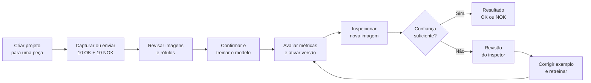

# 🏭 QualityAI

### Inspeção visual industrial simples, configurável e autotreinável

**Ensine o sistema com exemplos reais da sua peça e use inteligência artificial para apoiar uma inspeção mais rápida, consistente e rastreável.**

[Conheça o projeto](#visão-geral) · [Veja o fluxo](#como-funciona) · [Leia as Etapas 1 e 2](docs/etapas-1-e-2.md)

---

## Integrantes

- Luan Gabriel Vidal da Silva
- Marcio Alves
- Thiago Mendes

## Visão geral

O **QualityAI** é uma proposta de plataforma de inspeção visual para a indústria. Em vez de exigir programação ou conhecimento especializado em inteligência artificial, o sistema deverá permitir que um inspetor de qualidade crie um projeto, forneça imagens de referência e treine um classificador para uma determinada peça.

Na prova de conceito, cada projeto começa com **10 imagens de peças conformes (`OK`)** e **10 imagens de peças não conformes (`NOK`)**. Após revisar os rótulos, o inspetor autoriza o treinamento e utiliza o modelo para classificar novas imagens.

> O QualityAI foi pensado como uma ferramenta de **apoio à decisão**. A responsabilidade pela liberação de uma peça continua sendo humana, especialmente quando o modelo apresentar baixa confiança.

## Como funciona

| Entrada | Processamento | Saída |
| --- | --- | --- |
| Imagens obtidas por upload ou câmera | Treinamento confirmado pelo inspetor | Classificação `OK` ou `NOK` |
| Rótulos revisados por uma pessoa | Modelo versionado por projeto | Confiança e versão utilizada |
| Novas imagens de inspeção | Registro e revisão dos resultados | Encaminhamento para revisão humana |

## Proposta de valor

- **Consistência:** reduz a subjetividade entre diferentes inspeções.
- **Agilidade:** apoia a triagem visual de peças durante o processo de qualidade.
- **Flexibilidade:** permite criar um projeto e um modelo próprios para cada tipo de peça.
- **Acessibilidade:** oferece um fluxo de treinamento pensado para quem não programa.
- **Rastreabilidade:** relaciona cada resultado ao dataset e à versão do modelo utilizados.
- **Evolução contínua:** transforma correções humanas em novos exemplos para futuros treinamentos.

## Escopo inicial

### Incluído na proposta

- Criação de projetos para diferentes peças.
- Coleta de imagens por upload ou câmera/webcam.
- Dataset inicial com 10 exemplos `OK` e 10 exemplos `NOK`.
- Treinamento iniciado manualmente após a revisão do inspetor.
- Classificação binária de novas imagens.
- Revisão humana, armazenamento do projeto e versionamento do modelo.

### Fora do primeiro MVP

- Identificação automática do tipo específico de defeito.
- Marcação da posição do defeito na imagem.
- Decisão industrial totalmente autônoma.
- Integração direta com CLPs, esteiras, robôs ou sistemas ERP/MES.

## Limites da prova de conceito

Um conjunto de **20 imagens** é adequado para demonstrar a experiência de treinamento e inspeção, mas é pequeno demais para comprovar desempenho em produção. Iluminação, posição da câmera, acabamento, lote e variações naturais da peça podem afetar significativamente o resultado.

Antes de qualquer uso industrial, será necessário ampliar e diversificar o dataset, separar dados independentes para validação, definir critérios de aceitação com a engenharia de qualidade e realizar testes controlados no ambiente real.

## Documentação

As respostas completas solicitadas para a concepção do sistema estão reunidas em:

📘 **[Etapa 1 — Problema e contexto / Etapa 2 — Usuário e requisitos](docs/etapas-1-e-2.md)**

O documento contém a persona, a jornada do usuário, os requisitos funcionais e não funcionais, os casos de uso, as regras de negócio e os critérios de aceitação da proposta.

## Status do projeto

> **Fase atual:** concepção e documentação da prova de conceito.

| Marco | Estado |
| --- | :---: |
| Definição do problema e do público | ✅ Concluído |
| Jornada, requisitos e casos de uso | ✅ Concluído |
| Protótipo da interface | ⏳ Planejado |
| Treinamento e classificação | ⏳ Planejado |
| Validação com imagens reais | ⏳ Planejado |

---

**QualityAI — inteligência artificial com supervisão humana para uma qualidade industrial mais consistente.**

