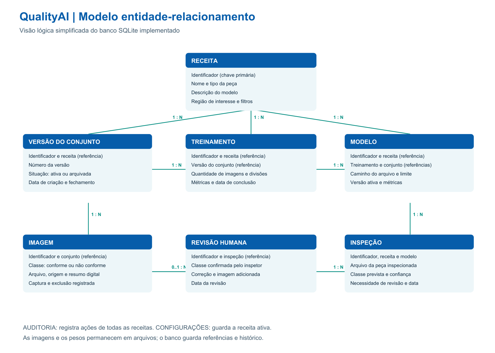

# Banco de dados local do QualityAI

O QualityAI utiliza **SQLite** para armazenar metadados e rastreabilidade. Imagens e modelos continuam no sistema de arquivos, enquanto o banco guarda seus caminhos, relacionamentos, versões, métricas e eventos. Essa separação evita inflar o banco com arquivos binários e facilita backup, auditoria e manutenção.

## Localização e operação

- Banco: `%LOCALAPPDATA%\QualityAI\qualityai.db`
- Imagens e modelos: `%LOCALAPPDATA%\QualityAI\projects\<receita>`
- Engine: SQLite integrado ao Python, sem servidor e sem internet.
- Integridade: chaves estrangeiras habilitadas.
- Concorrência: modo WAL e espera controlada de até cinco segundos.
- Durabilidade: transações atômicas para alterações relacionadas.
- Evolução: versão inicial registrada por `PRAGMA user_version = 1`.

## Responsabilidades das tabelas

| Tabela | Responsabilidade |
| --- | --- |
| `recipes` | Cadastro da receita, tipo de peça, descrição, caminho e pré-processamento |
| `dataset_versions` | Versões ativas e arquivadas do dataset de cada receita |
| `image_samples` | Índice das imagens `OK/NOK`, origem, hash e exclusão lógica |
| `training_runs` | Execuções de treinamento, quantidade de imagens, folds e métricas |
| `model_versions` | Modelos gerados, dataset de origem, limite de confiança e versão ativa |
| `inspections` | Resultado, confiança, modelo utilizado e imagem da inspeção |
| `human_reviews` | Confirmações e correções realizadas pelo inspetor |
| `audit_events` | Linha do tempo de ações relevantes para rastreabilidade |
| `app_settings` | Receita ativa e outras preferências globais |

## Regras principais

1. Uma receita pode ter várias versões de dataset, mas apenas uma versão ativa.
2. Cada imagem pertence a uma receita e a uma versão específica do dataset.
3. Cada treinamento aponta para o dataset que o alimentou.
4. Cada modelo aponta para seu treinamento e suas métricas.
5. Cada inspeção registra exatamente qual modelo gerou a previsão.
6. Uma revisão humana pode confirmar ou corrigir a previsão e realimentar o dataset.
7. Ao limpar um dataset, a versão anterior é arquivada e uma nova versão vazia é aberta.
8. Arquivos excluídos recebem registro temporal no banco, preservando a trilha de auditoria.

## Segurança e manutenção

O banco não armazena senhas neste protótipo e não é exposto na rede. Para uma distribuição industrial, o backup deve incluir o arquivo `qualityai.db` junto com a pasta `projects`, pois o banco referencia imagens e modelos externos. Copiar apenas um dos dois deixa o backup incompleto.

O esquema executável está em [`qualityai/schema.sql`](../qualityai/schema.sql), e a camada transacional está em [`qualityai/database.py`](../qualityai/database.py).
